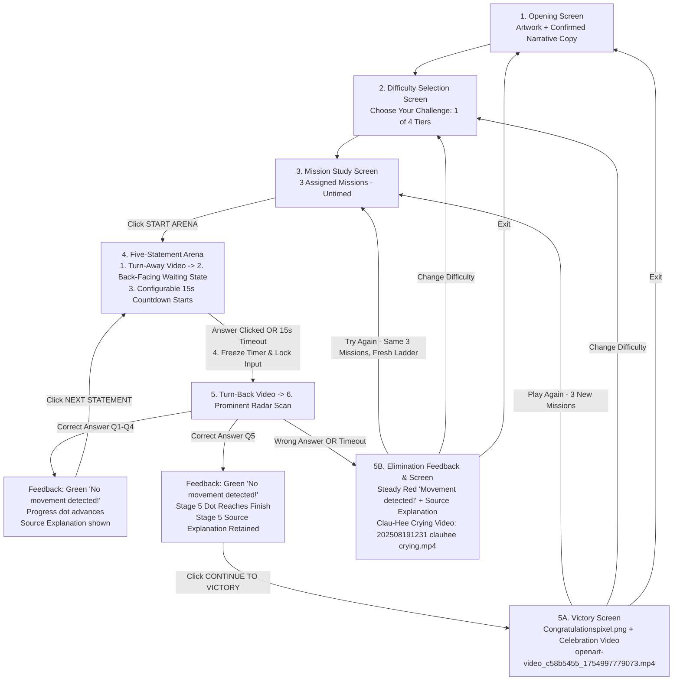

# Product Requirements Document (PRD): Red Light - Green Light (S-Quit Boring Compliance)

**Document Date:** October 22, 2026  
**Document Status:** Draft for review  
**File Location:** `docs/plans/2026-10-22-red-light-green-light-prd.md`  
**Selected Interactive Prototype:** Option 1 — Classic Split Arcade (`mockups/index.html`)  

---

## 1. Executive Summary & Vision

**Red Light - Green Light** transforms corporate compliance training into a high-stakes, interactive survival quiz inspired by the visual language and tension of *Squid Game*. Hosted by the watchful compliance doll **Clau-Hee**, the game challenges players on corporate gift, hospitality, and anti-bribery policies.

Players select one of four difficulty tiers, study three randomly assigned missions containing real policy rules, and face five consecutive True/False compliance statements under time pressure. One wrong answer or timeout is treated as "movement" resulting in immediate elimination. Five consecutive correct answers wins the game.

### Core Experience Pillars
1. **Zero-Tolerance Survival Stakes:** Elimination on a single error creates genuine motivation to read, understand, and retain compliance policy rules.
2. **Pink Pixel Aesthetics (Classic Split Arcade):** Option 1 layout in `mockups/index.html` with retro 16:9 pixel-art styling on desktop (Clau-Hee and radar on the left; statement, timer, answer buttons, and explanation on the right) and a responsive mobile layout with large touch controls.
3. **Decoupled Visual Pacing:** Clau-Hee's state transitions (turn away, back-facing wait, turn back) are cleanly decoupled from the countdown timer. Video asset duration does not dictate player answering time.
4. **Prominent Stylized Radar "Swoosh" & Accessible Alerts:** A stylized, answer-driven circular radar scope featuring a stationary grid and player silhouette overlaid by a bright rotating radial beam, glowing leading edge, translucent scanning wedge, and fading trail. There is no webcam or physical movement tracking, and Clau-Hee has no laser eyes. Correct answers trigger a green `"No movement detected!"` confirmation; wrong answers or timeout trigger a steady red target lock `"Movement detected!"` without flashing or strobing.
5. **Reinforced Educational Feedback:** Complete policy rationales are displayed on all answers (including the crucial Stage 5 final statement, which remains displayed until the player clicks `CONTINUE TO VICTORY`).

---

## 2. Working Brief & Source Materials Status

### 2.1 File Access & Audit Report
All supplied project files in `E:\CGC\Google Immersion\Lab 1 - Game` and `Red-Light-Green-Light` were accessed and parsed without errors (0 unreadable files):
- `20250727 - CS - Red Light Green Light - Game Design Doc22.pptx` (July 27 Game Design Deck) – **Detailed Working Brief**
- `Assets - Sequence .msg` (Assets & Sequence Email) – **Detailed Working Brief**
- `20250707 - JSON Scrolls in Word.docx` (21 Mission Scrolls & 189 Statement Bank) – **Policy Content Source of Truth**
- `20250528 - CS - SQUID Game Challenge Continued...docx` (May Concept Document) – **Background Reference**
- `BUTTONS SCREENS 16 - 9.zip` (Screen mockups, buttons, icons, banners) – **Visual Asset Pack**
- Video & image files (`202508191231 clauhee crying.mp4`, `girl tree.jpg`, `girl tree back.jpg`, `girl turning towards tree.mp4`, `girl turning towards the camera.mp4`, `openart-video_c58b5455_1754997779073.mp4`) – **Media Assets**

### 2.2 Confirmed Design Decisions
- **Selected Prototype Layout:** **Option 1: Classic Split Arcade** (`mockups/index.html`) with pink pixel styling. On desktop, Clau-Hee and the radar remain on the left, with the statement, timer, answer buttons, and explanation on the right. On mobile, the layout adapts into a readable stacked layout with large touch controls.
- **Player-Facing Terminology:** Player-facing copy uses **"missions"** (`Mission 1`, `Mission 2`, `Mission 3`, and `🧠 Advanced — "Mission Master"`), while preserving the source `scroll_number` IDs and policy content internally.
- **Configurable Default Timer:** A **15-second configurable default** applies across all difficulty levels. The countdown begins strictly when Clau-Hee has entered the back-facing waiting state and the statement and answer controls are ready.
- **Decoupled Animation States:** The countdown runs while Clau-Hee is in the back-facing waiting state (`girl tree back.jpg`). Video durations remain completely independent of the player's answering window.
- **Immediate Evaluation & Radar Swoosh:** Submitting True/False or reaching timeout (`0.0s`) immediately freezes the timer and locks further input, plays the actual turn-back video (`girl turning towards the camera.mp4`), runs a visible circular radar scan ("swoosh" with rotating radial beam, glowing leading edge, translucent scanning wedge, and fading trail over stationary grid/silhouettes), and displays the result and full source explanation.
- **Stage 5 Explanation Preservation:** Answering Stage 5 correctly retains the Stage 5 explanation until the player explicitly clicks `CONTINUE TO VICTORY`.
- **Celebration Asset Confirmed:** Attachment `openart-video_c58b5455_1754997779073.mp4` extracted from `Assets - Sequence .msg` is available in `assets/` (no longer a missing asset) and plays on the Victory Screen alongside `Congratulationspixel.png`.
- **Steady Elimination Alert:** Elimination uses steady, non-strobe red feedback elements (`"Movement detected!"`) for accessibility.
- **Retry & Play Again Mechanisms:** Clicking `TRY AGAIN` after elimination preserves the 3 assigned missions, returns to the Mission Study screen, and generates a fresh 5-question ladder. Clicking `PLAY AGAIN` after victory assigns 3 new missions from the same difficulty level.

---

## 3. Policy Content Clarifications & Metadata Architecture

> [!NOTE]
> In accordance with project governance, no policy rules, answers, or difficulty classifications may be silently modified or invented. The following issues and clarifications are recorded:

### 3.1 Metadata Architecture (Mission/Scroll vs. Question Difficulties)
The source material maintains two distinct, independent difficulty metadata layers:
1. **Mission/Scroll-Level Difficulty (`difficulty_level`):** The 21 scrolls are categorized into 4 tiers in the source JSON:
   - Scrolls 1 to 4: `difficulty_level: "1 out of 4"` (🐣 Beginner — "Compliance Curious")
   - Scrolls 5 to 10: `difficulty_level: "2 out of 4"` (🧐 Intermediate — "Policy Padawan")
   - Scrolls 11 to 16: `difficulty_level: "3 out of 4"` (🧠 Advanced — "Mission Master")
   - Scrolls 17 to 21: `difficulty_level: "4 out of 4"` (🦾 Champion — "The Red Flag Sniper")
2. **Question-Level Difficulty (`difficulty`):** Each of the 9 statements within every scroll is independently tagged as `Easy`, `Medium`, or `Hard` (overall bank: 64 Easy, 70 Medium, 55 Hard — all 189 questions tagged and eligible). These labels govern the 5-question difficulty progression within an attempt.

### 3.2 Approved Content Corrections & Source Resolutions
The original Word document (`20250707 - JSON Scrolls in Word.docx`) is preserved untouched as the historical source, with the following approved content corrections recorded and applied to the working question bank (`mockups/all_scrolls.json`):
1. **Scroll 4, Question 9 Missing Difficulty (Resolved):**
   - Statement: *"Publicly shared water bottles with company branding are considered high risk."*
   - **Resolution:** Set `"difficulty": "Easy"`, retain `"answer": "False"` and existing explanation (*"Such public, promotional items are typically low risk."*), and include the question in difficulty-anchored selection.
2. **Low-Value Promotional Items Registration Exemption (Resolved):**
   - **Confirmed Rule:** *Low-value promotional items do not need to be registered. Examples include mouse mats, pens and mugs.*
   - **Resolution:** Harmonized affected rules, examples, statements, and explanations across the question bank while preserving all other gift restrictions (government officials, sensitive periods, cumulative patterns, and concealed gifts):
     - *Scroll 1, Rule 6:* Updated to note the exemption: *"If all criteria met → register for approval (except low-value promotional items such as mouse mats, pens, and mugs, which do not need to be registered); If you receive a gift that does not meet the criteria, politely decline or return."*
     - *Scroll 1, Question 4 (€25 branded charger at a public event):* Removed the registration condition from the explanation so it reads: *"Low-value, openly distributed promotional items are generally compliant and do not need to be registered."* (Retains `"answer": "True"`, `"difficulty": "Easy"`).
     - *Scroll 1, Question 7:* Updated statement from *"All compliant gifts must still be registered (ideally before acceptance)."* to *"All compliant gifts, except low-value promotional items, must still be registered (ideally before acceptance)."* Retained `"answer": "True"` and `"difficulty": "Easy"`, and updated the explanation to: *"Even gifts that meet all requirements must be logged for transparency, except low-value promotional items (such as mouse mats, pens, and mugs), which do not need to be registered."*
     - *Scroll 2, Rule 1, Example 1 & Question 1:* Harmonized phrasing to *"low-value promotional items (e.g., mouse mats, pens, and mugs)"* and updated Example 1 so it illustrates the conference promotional-item exemption rather than logging a conference promotional item.
     - *Scroll 5, Rule 5 & Scroll 7, Rule 1 / Question 1:* Harmonized *"All gifts... must be registered/logged"* wording to explicitly include the exception for low-value promotional items (such as mouse mats, pens, and mugs), matching Scroll 7 Question 1's existing explanation while keeping `"answer": "True"` and `"difficulty": "Easy"`.
3. **Declined and Returned Gifts (Confirmed Complementary Rule):**
   - Scroll 1 Rule 6 instructs employees to politely decline or return a non-compliant gift, while Scroll 2 Rule 4 / Question 3 and Scroll 7 Rule 4 / Question 3 require documenting/logging declined or returned gifts.
   - **Resolution:** Confirmed as complementary instructions (politely decline or return a non-compliant gift *and* document that action), not an unresolved conflict.
4. **Malformed Source JSON (Resolved in Parser):** In `20250707 - JSON Scrolls in Word.docx`, malformed JSON syntax (orphaned closing brace `},` before Scroll 1, missing quote on `"difficulty level: 1 out of 4`, unclosed multi-line string literals in Scroll 4 Rule 6 and Scroll 8 Rule 1, trailing commas) is sanitized in `mockups/all_scrolls.json`.

---

## 4. Player Journey & Screen Flow

Connected journey: **Opening → Difficulty selection → Mission study → Five-statement arena → Feedback → Victory or elimination.**

### Screen 1: Opening Screen
- **Layout:** Places the supplied opening artwork (`Image screen - Game explanation.png`, cropped/scaled so it fills its allotted frame neatly with zero black gap while keeping Clau-Hee and the finish ribbon visible) beside the confirmed opening narrative copy on desktop, adapting into a stacked arrangement on mobile.
- **Confirmed Opening Copy:**
  > **Let’s Quit Boring Compliance!**
  >
  > One wrong move, and you’re out…
  >
  > In this game, knowing the rules isn’t just helpful—it’s your only way forward.
  >
  > You’ll be assigned three missions. Study their rules carefully, then face five true-or-false statements.
  >
  > Clau-Hee scans for any signs of non-compliance.
  >
  > Answer wrong or run out of time? That’s movement. You’re caught. You’re out.
  >
  > 🟢 Green light: correct answer? Move forward.  
  > 🔴 Red light: wrong answer or time’s up? Elimination.
  >
  > Five questions. 15 seconds each. Five correct answers to reach the finish line.
  >
  > Think fast. Stay sharp!
  >
  > Ready to prove compliance isn’t boring—but a matter of survival?
  >
  > Let the test begin…
- **Controls:** `CHOOSE YOUR CHALLENGE` button to proceed to Difficulty Selection.

### Screen 2: Difficulty Selection Screen
- **Layout & Selection Behavior:** Four full-width horizontal cards stacked vertically (`Beginner`, `Intermediate`, `Advanced`, `Champion`) with single-select radio behavior, keyboard accessibility (`Enter`/`Space`), clear selection indicators, large readable body text (~18–20px on desktop), balanced content-hugging padding, and vertical scrolling where needed on smaller screens.
- **Heading:** `Choose Your Challenge`
- **Introduction:**
  > *"Start as a rookie and rise to become the Red Flag Sniper. Choose your level and put your knowledge to the test. Choose wisely. Clau-Hee’s always watching… 👀"*
- **Confirmed Level Copy:**
  1. **🐣 Beginner — “Compliance Curious”** (Scrolls 1 to 4)
     > *"You’ve survived HR onboarding and know that buying someone a coffee shouldn’t buy you special treatment. This level eases you in with straightforward missions and clear statements. Study carefully: even here, one wrong answer ends your attempt."*
  2. **🧐 Intermediate — “Policy Padawan”** (Scrolls 5 to 10)
     > *"You’ve skimmed a policy PDF once and lived to tell the tale. At this level, you’ll face murkier scenarios—timing, transparency, and terminology start to matter. Be alert, or you’ll be eliminated before you can say “intent to influence.”"*
  3. **🧠 Advanced — “Mission Master”** (Scrolls 11 to 16)
     > *"You’ve quoted the Code of Conduct at parties. You know when a gift is too good to be true. Expect closer calls, subtle distinctions, and situations where context changes the answer. One wrong move and it’s a red light for you."*
  4. **🦾 Champion — “The Red Flag Sniper”** (Scrolls 17 to 21)
     > *"You’ve memorised the exceptions to the exceptions and can smell a compliance breach from 50 metres. This is elite mode: the toughest scenarios, the finest distinctions, and red flags hiding in the details. Only the bold, the brilliant, or the slightly obsessed survive this level."*
- **Controls:** Selectable tier cards and `CONFIRM & STUDY MISSIONS` button.

### Screen 3: Mission Study Screen
- **Scope Banner:** `– Anti-Bribery & Corruption – Gift policy` (`SCOPE.png`).
- **Instructions:**
  > *"Below you will find 3 mission folders assigned from your selected challenge tier. Study their policy rules carefully—there is no time limit on this screen. When you enter the arena, you will face 5 true-or-false statements."*
- **Tabs:** Three interactive mission tabs (`Mission 1`, `Mission 2`, `Mission 3`) displaying each assigned mission's verbatim rules from the source bank (preserving internal `scroll_number` metadata behind the scenes).
- **Controls:** `START ARENA` button (untimed study phase).

### Screen 4: Five-Statement Arena & Feedback (Option 1: Classic Split Arcade)
Divided into two coordinated panels on desktop (and stacked with large touch controls on mobile):
- **Left Panel: Clau-Hee Stage, Prominent Radar Scope & Progress Track**
  - **6-Step Statement Sequence:**
    1. *Turn-Away Video:* Plays the actual turn-away video (`girl turning towards tree.mp4`).
    2. *Back-Facing Waiting State:* Displays `girl tree back.jpg`.
    3. *Countdown Active:* Starts the configurable 15-second countdown only when the back-facing state, statement, and answer controls are ready.
    4. *Input Lock:* An answer or timeout (`0.0s`) immediately freezes the timer and locks further input.
    5. *Turn-Back Video:* Plays the actual turn-back video (`girl turning towards the camera.mp4`).
    6. *Radar Scan & Feedback:* Runs the visible radar scan, then reveals the result and complete verbatim source explanation.
  - **Prominent Radar "Swoosh":** Circular radar scope (`Radar.png` backdrop + stationary SVG grid, crosshairs, and player silhouette) overlaid by a bright rotating radial beam, glowing leading edge, translucent scanning wedge, and fading trail.
    - Correct answers produce a green confirmation: `"No movement detected!"`.
    - Wrong answers or timeout produce a steady red target lock: `"Movement detected!"`.
    - Stylized answer-driven scanner only (no webcam, no physical movement tracking, no laser eyes on Clau-Hee).
  - **Progress Track:** 5-stage track (`progress dot.png`) showing the player's progress toward the finish line.
- **Right Panel: Statement, Timer, Answer Buttons & Explanation**
  - **Countdown Timer:** Configurable default of 15.0 seconds.
  - **Statement Card:** High-contrast typography displaying the statement, source mission title, and difficulty badge (`Easy`, `Medium`, `Hard`).
  - **Action Buttons:** Large `TRUE` and `FALSE` buttons (`>= 56px` touch height on mobile).
  - **Feedback & Explanation Panel:**
    - *Correct Answer (Stages 1–4):* Green `"No movement detected!"` header, player choice vs. correct answer, verbatim policy explanation, and `NEXT STATEMENT` button.
    - *Correct Answer (Stage 5):* Green `"No movement detected!"` header, verbatim Stage 5 policy explanation retained until the player clicks `CONTINUE TO VICTORY`.
    - *Wrong Answer or Timeout:* Steady red `"Movement detected!"` alert, verbatim policy explanation, and `CONTINUE TO ELIMINATION SCREEN` button (plus immediate access to `TRY AGAIN`).

### Screen 5A: Victory Screen (Stage 5 Cleared)
- **Visuals:** Finish line celebration displaying `Congratulationspixel.png` alongside the confirmed Clau-Hee celebration video (`openart-video_c58b5455_1754997779073.mp4`).
- **Controls:** `PLAY AGAIN` (`PLAY AGAIN.png` — assigns 3 new missions from the same level), `CHANGE DIFFICULTY`, `EXIT` (`EXIT.png`).

### Screen 5B: Elimination Screen (Wrong Answer or Timeout)
- **Visuals:** Steady red alert frame and Clau-Hee crying video (`202508191231 clauhee crying.mp4`).
- **Status & Policy Learning Box:** Missed statement text, player's choice vs. correct answer, and complete verbatim policy explanation.
- **Controls:** `TRY AGAIN` (`TRY AGAIN.png` — preserves the 3 assigned missions, returns to Mission Study, and generates a fresh 5-statement ladder), `CHANGE DIFFICULTY`, `EXIT` (`EXIT.png`).

---

## 5. Game Mechanics & Progression Rules

### 5.1 Difficulty Progression ("Never Decreases")
- **Rule:** Across the 5 statements in an attempt, question difficulty **must never decrease**:
  $$\text{Difficulty}(Q_1) \le \text{Difficulty}(Q_2) \le \text{Difficulty}(Q_3) \le \text{Difficulty}(Q_4) \le \text{Difficulty}(Q_5)$$
  where $\text{Easy} \le \text{Medium} \le \text{Hard}$.
- **Repeated Levels Allowed:** Sequences such as `[Easy, Easy, Medium, Medium, Hard]`, `[Easy, Medium, Medium, Medium, Hard]`, or `[Easy, Medium, Medium, Hard, Hard]` are valid.
- **Mandatory Anchors:**
  - Stage 1 is strictly **Easy**.
  - Stage 5 is strictly **Hard**.
- **No Duplicates:** All 5 selected statements must be distinct within an attempt.
- **Scroll Origin:** All 5 statements must be drawn from the 27 statements belonging to the 3 assigned scrolls.

### 5.2 Timer & Decoupled State Execution
1. **Transition (Turn Away):** Clau-Hee turns to the tree (`girl turning towards tree.mp4`).
2. **Ready & Wait State:** Clau-Hee transitions to the back-facing waiting state (`girl tree back.jpg`).
3. **Timer Trigger:** Statement text and True/False buttons render. The 15-second countdown begins.
4. **Evaluation Trigger:**
   - **On Button Click:** Timer immediately freezes. Buttons disable. Clau-Hee executes the turn-back animation (`girl turning towards the camera.mp4`). Radar sweeps. Result and explanation display.
   - **On 15.00s Expiry:** Buttons disable. Clau-Hee executes the turn-back animation. Radar triggers steady red movement alarm. Elimination result and explanation display.

---

## 6. Media & Asset Mapping

| Component / State | Asset Name | Status / Source | Notes |
|---|---|---|---|
| **Opening Backdrop** | `OPENING SCREEN 4800 x 2700.png` | Supplied (`BUTTONS SCREENS 16 - 9.zip`) | 16:9 pixel background |
| **Opening Artwork** | `Image screen - Game explanation.png` | Supplied (`assets/`) | Side-by-side artwork on Opening Screen |
| **Arena Frame** | `PLAY SCREEN4800 x 2700.png` | Supplied (`BUTTONS SCREENS 16 - 9.zip`) | Split arena layout |
| **Clau-Hee Turn Away** | `girl turning towards tree.mp4` | Supplied (`assets/`) | Step 1: Transition to back-facing |
| **Clau-Hee Waiting State** | `girl tree back.jpg` | Supplied (`assets/`) | Step 2 & 3: Back-facing waiting state during 15s countdown |
| **Clau-Hee Turn Back** | `girl turning towards the camera.mp4` | Supplied (`assets/`) | Step 5: Evaluation transition |
| **Elimination Video** | `202508191231 clauhee crying.mp4` | Supplied (`assets/`) | Plays upon wrong answer / timeout |
| **Celebration Video** | `openart-video_c58b5455_1754997779073.mp4` | Confirmed & Available (`assets/`) | Extracted from `Assets - Sequence .msg` (no longer missing) |
| **Victory Visual** | `Congratulationspixel.png` | Supplied (`assets/`) | Static victory banner alongside celebration video |
| **Radar & Track** | `Radar.png` + SVG Radar Swoosh + `progress dot.png` | Supplied / programmatic | Stationary grid/silhouette + rotating beam, wedge & fading trail |
| **Buttons & Icons** | `start.png`, `TRY AGAIN.png`, `PLAY AGAIN.png`, `EXIT.png`, `SCOPE.png` | Supplied (`BUTTONS SCREENS 16 - 9.zip`) | Interactive UI controls |

---

## 7. Acceptance Criteria

### Feature 1: Difficulty Selection & Mission Allocation
- **AC 1.1:** The user can select exactly one of 4 distinct tiers: Beginner — "Compliance Curious" (Scrolls 1–4), Intermediate — "Policy Padawan" (Scrolls 5–10), Advanced — "Mission Master" (Scrolls 11–16), and Champion — "The Red Flag Sniper" (Scrolls 17–21).
- **AC 1.2:** Selecting a tier randomly allocates exactly 3 unique missions (scrolls) from that tier's numeric range, using "missions" in player-facing copy while preserving internal scroll IDs.
- **AC 1.3:** The untimed study screen presents all 3 assigned missions with their complete verbatim rules.
- **AC 1.4:** The user can switch between mission tabs freely and start the arena only when ready.

### Feature 2: 5-Statement Ladder & Non-Decreasing Difficulty
- **AC 2.1:** Exactly 5 unique statements are drawn from the 27 statements of the 3 assigned missions.
- **AC 2.2:** Question difficulty never decreases across the 5 stages ($Q_1 \le Q_2 \le Q_3 \le Q_4 \le Q_5$). Repeated difficulty tiers are permitted.
- **AC 2.3:** Stage 1 is strictly an `Easy` statement; Stage 5 is strictly a `Hard` statement.
- **AC 2.4:** Statement text, answer keys, and explanations must match `20250707 - JSON Scrolls in Word.docx` verbatim.

### Feature 3: Configurable Timer, 6-Step Sequence & Prominent Radar Swoosh
- **AC 3.1:** The countdown timer defaults to 15.0 seconds and is configurable.
- **AC 3.2:** For each statement: (1) play the actual turn-away video (`girl turning towards tree.mp4`), (2) enter the back-facing waiting state (`girl tree back.jpg`), and (3) start the 15-second countdown only when that state, the statement, and answer controls are ready.
- **AC 3.3:** Answering window duration is governed exclusively by the countdown timer, independent of video clip lengths.
- **AC 3.4:** Clicking True or False (or reaching 0.0s timeout) immediately freezes the countdown and locks further input, plays the actual turn-back video (`girl turning towards the camera.mp4`), and runs the visible circular radar "swoosh" scan (stationary grid/silhouette with bright rotating radial beam, glowing leading edge, translucent scanning wedge, and fading trail).
- **AC 3.5:** Correct answers produce a green confirmation (`"No movement detected!"`); wrong answers or timeout produce a steady red target lock (`"Movement detected!"`) without flashing or strobing.

### Feature 4: Feedback & Educational Explanation Flow
- **AC 4.1:** All answers (correct and incorrect, stages 1 through 5) display the correct True/False answer and full verbatim policy explanation.
- **AC 4.2:** On correct answers for Stages 1 to 4, the progress dot advances and a `NEXT STATEMENT` button appears.
- **AC 4.3:** On a correct answer for Stage 5, the progress dot reaches the finish line and the Stage 5 explanation is retained until the player clicks `CONTINUE TO VICTORY`.
- **AC 4.4:** On incorrect answer or timeout, the Clau-Hee crying video (`202508191231 clauhee crying.mp4`) plays, steady red `"Movement detected!"` displays with the missed question's explanation, and retry controls are provided.

### Feature 5: Retry & Progression State Handlers
- **AC 5.1:** Clicking `TRY AGAIN` on elimination preserves the 3 assigned missions, returns the player to the Mission Study screen, and generates a fresh 5-question ladder obeying all progression rules.
- **AC 5.2:** Clicking `CHANGE DIFFICULTY` resets all mission and question assignments and returns to Difficulty Selection.
- **AC 5.3:** Clicking `PLAY AGAIN` on victory assigns 3 new missions from the same difficulty level and generates a new 5-question ladder.

---

## 8. Publication Governance & Out of Scope for this PRD
- **Publication Assignment & Review Gate:** Public release and deployment of the first demo are assigned to **Mada** following public-content clearance by **Claudia** and technical review of the companion Technical Design Specification (`docs/plans/2026-10-25-red-light-green-light-technical-design-spec.md`).
- **Out of Scope for this PRD:**
  - Underlying client/server architecture, framework selection, and deployment configuration (documented in `docs/plans/2026-10-25-red-light-green-light-technical-design-spec.md`).
  - Policy content authoring, editing tools, or unilateral resolution of source text contradictions.
