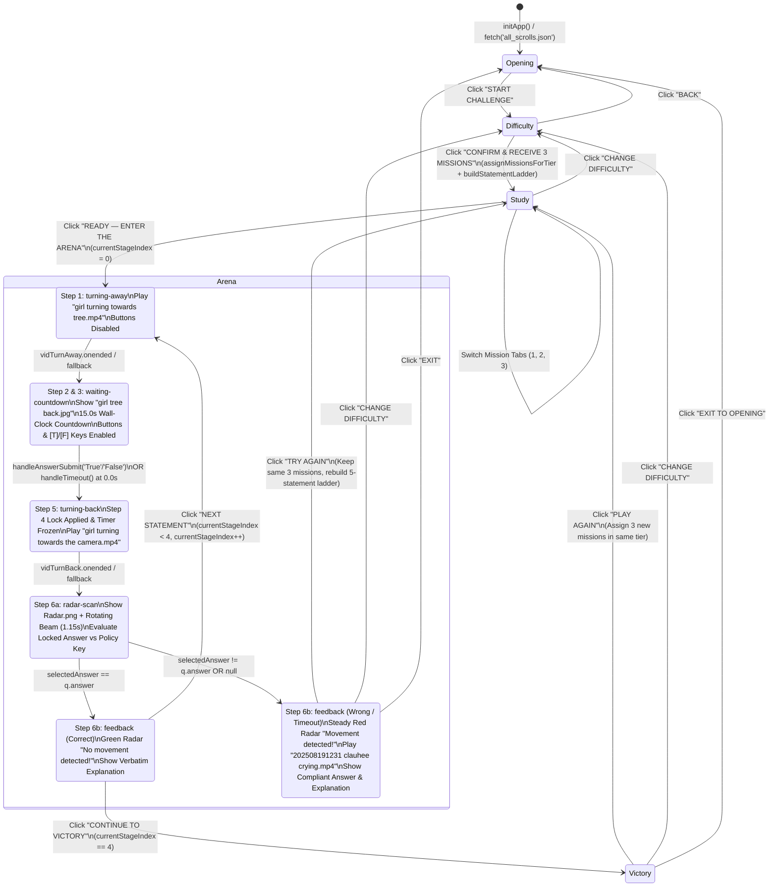
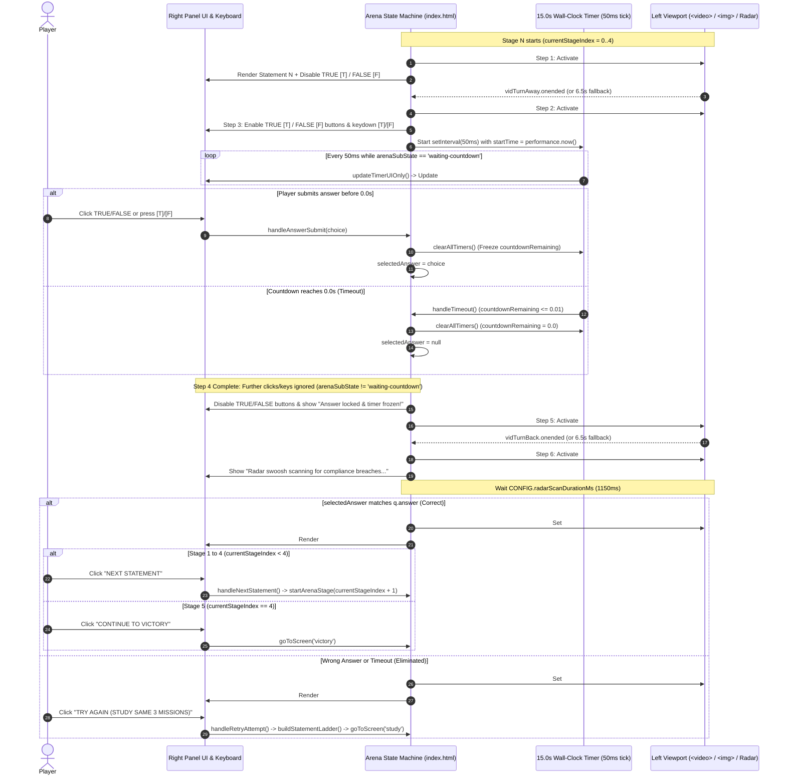
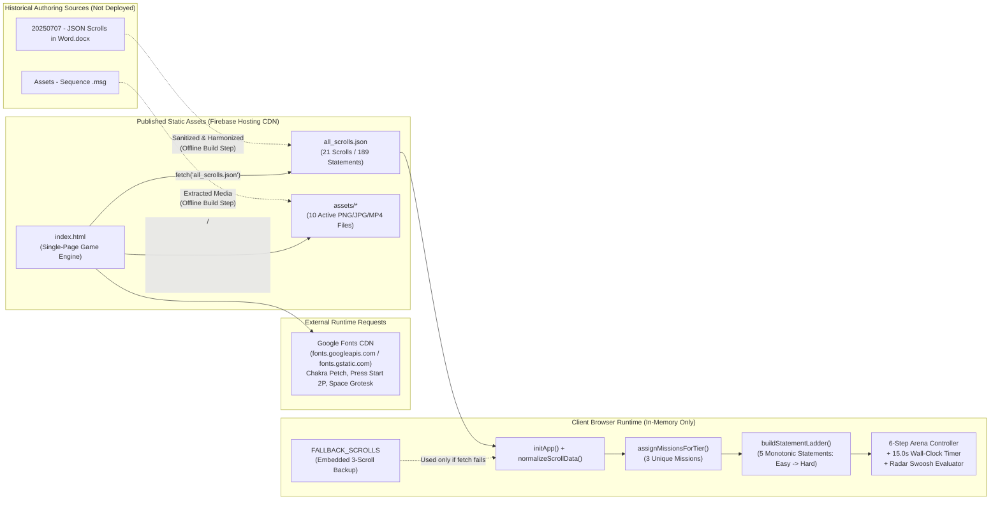

# Technical Design Specification: Red Light - Green Light (S-Quit Boring Compliance)

- **Document Status:** Draft for review
- **Date:** 2026-10-25
- **Target Project:** `red-light-green-light-lab` (Firebase Hosting — First Public Demo)
- **Content Approver:** Claudia (`claudia@aigenticcompliance.com`)
- **Publication & Deployment Owner:** Mada (`madalina@aigenticcompliance.com`)
- **Related Documents:**
  - Product Requirements Document: [2026-10-22-red-light-green-light-prd.md](file:///e:/CGC/Google%20Immersion/Lab%201%20-%20Game/Red-Light-Green-Light/docs/plans/2026-10-22-red-light-green-light-prd.md)
  - Project Agents Guide: [AGENTS.md](file:///e:/CGC/Google%20Immersion/Lab%201%20-%20Game/Red-Light-Green-Light/AGENTS.md)
  - Approved Prototype: [mockups/index.html](file:///e:/CGC/Google%20Immersion/Lab%201%20-%20Game/Red-Light-Green-Light/mockups/index.html)
  - Sanitized Question Bank: [mockups/all_scrolls.json](file:///e:/CGC/Google%20Immersion/Lab%201%20-%20Game/Red-Light-Green-Light/mockups/all_scrolls.json)
  - Local Preview Server: [mockups/serve.js](file:///e:/CGC/Google%20Immersion/Lab%201%20-%20Game/Red-Light-Green-Light/mockups/serve.js)

---

## 1. Architecture and File Structure

### 1.1 Existing Prototype Architecture
The approved **Option 1: Classic Split Arcade** prototype is a zero-build, purely client-side single-page web application implemented with vanilla HTML5, CSS3, and ES6+ JavaScript. It has no backend application server, database, or runtime framework dependencies.

- **Single-Page Application ([`mockups/index.html`](file:///e:/CGC/Google%20Immersion/Lab%201%20-%20Game/Red-Light-Green-Light/mockups/index.html))**:
  - Contains all layout styling, responsive rules (`16:9` split arcade frame on desktop; stacked responsive layout on mobile viewports), state management, DOM rendering, countdown timers, SVG radar swoosh overlay, and media playback orchestration in a single file (`2,469` lines).
  - Loads the full question bank at startup via `fetch('all_scrolls.json')` (resolved relative to `mockups/index.html`).
  - Includes an embedded `FALLBACK_SCROLLS` constant (3 Beginner scrolls with 3 statements each) so the UI remains playable if `all_scrolls.json` fails to load (e.g. when opened directly via `file://`).
  - References all image and video assets using parent-relative paths (`../assets/<filename>`).
- **Sanitized Question Bank ([`mockups/all_scrolls.json`](file:///e:/CGC/Google%20Immersion/Lab%201%20-%20Game/Red-Light-Green-Light/mockups/all_scrolls.json))**:
  - Static JSON array containing all **21 compliance missions (scrolls)** and **189 True/False statements** (`64 Easy`, `70 Medium`, `55 Hard`, `0 untagged`), including all approved syntax repairs and policy harmonizations (Scroll 4 Question 9 difficulty set to `"Easy"` and the low-value promotional items registration exemption applied across Scrolls 1, 2, 5, and 7).
- **Local Development Server ([`mockups/serve.js`](file:///e:/CGC/Google%20Immersion/Lab%201%20-%20Game/Red-Light-Green-Light/mockups/serve.js))**:
  - Minimal zero-dependency Node.js (`http`, `fs`, `path`) static file server listening on port `8085` (`PORT` environment variable configurable) rooted at the repository root (`..` relative to `mockups/`).
  - Implements HTTP `Range` request handling (`206 Partial Content`) so HTML5 `<video>` elements can seek and replay `.mp4` files smoothly during local browser testing.
  - Redirects `/` to `/mockups/index.html` (`302`).

### 1.2 Current Workspace File Structure
```text
Red-Light-Green-Light/
├── AGENTS.md                                          # Project constraints & agent guidelines (Internal)
├── docs/
│   └── plans/
│       ├── 2026-10-22-red-light-green-light-prd.md    # Player Experience PRD (Internal)
│       └── 2026-10-25-red-light-green-light-technical-design-spec.md  # This specification (Internal)
├── mockups/
│   ├── index.html                                     # Approved single-page game application (Public candidate)
│   ├── all_scrolls.json                               # Sanitized 21-scroll question bank (Public candidate)
│   ├── serve.js                                       # Local Node.js preview server (Dev-only)
│   └── screenshots/                                   # Verification screenshots (Dev-only)
├── assets/                                            # Extracted media assets (10 active runtime files + unused assets)
│   ├── Image screen - Game explanation.png            # Active: Opening screen artwork
│   ├── girl tree.jpg                                  # Active: Arena idle / radar stage poster
│   ├── girl turning towards tree.mp4                  # Active: Step 1 turn-away video
│   ├── girl tree back.jpg                             # Active: Step 2 back-facing waiting image
│   ├── girl turning towards the camera.mp4            # Active: Step 5 turn-back video
│   ├── 202508191231 clauhee crying.mp4                # Active: Step 6 elimination video
│   ├── Radar.png                                      # Active: Step 6 circular radar base texture
│   ├── Gameover-1.pngpixel.png                        # Active: Elimination header graphic
│   ├── openart-video_c58b5455_1754997779073.mp4       # Active: Victory celebration video
│   ├── Congratulationspixel.png                       # Active: Victory header graphic
│   └── [47 additional unused/concept PNGs & MP4]      # Unused in runtime code (see Section 4.1)
├── 20250528 - CS - SQUID Game Challenge...docx        # Historical concept document (Internal - DO NOT PUBLISH)
├── 20250707 - JSON Scrolls in Word.docx               # Historical raw question bank (Internal - DO NOT PUBLISH)
├── 20250727 - CS - Red Light Green Light...pptx       # Historical slide deck (Internal - DO NOT PUBLISH)
├── Assets - Sequence .msg                             # Outlook email with internal addresses (Internal - DO NOT PUBLISH)
├── BUTTONS SCREENS 16 - 9.zip                         # Raw UI art archive (Internal - DO NOT PUBLISH)
└── [Duplicate root-level media files]                 # Duplicate copies of MP4/PNG/JPG files at repo root
```

### 1.3 Proposed Approach for the First Public Demo (Minimal Release Changes)
To keep changes to the approved prototype minimal and zero-risk while preventing accidental publication of internal documents (`.docx`, `.pptx`, `.msg`, `docs/`, `AGENTS.md`), two deployment packaging options are available for Mada:

#### Option A: Clean `public/` Staging Directory with Root-Relative Asset Paths (Recommended)
Assemble a dedicated `public/` (or `dist/`) folder containing **only** the public runtime files:
```text
public/
├── index.html              # Copy of mockups/index.html with "../assets/" updated to "assets/" (or served via rewrite)
├── all_scrolls.json        # Copy of mockups/all_scrolls.json
└── assets/                 # Only the 10 active runtime media assets (or cleared assets/ folder)
```
- **Why Recommended:** Physically isolates public build artifacts from internal `.msg` emails, `.docx`/`.pptx` files, and `docs/`. Serves the game cleanly at the root URL (`https://<project>.web.app/`) without exposing `/mockups/` in the player-facing URL.
- **Required Code Change if Serving at Root (`/`):** Because [`mockups/index.html`](file:///e:/CGC/Google%20Immersion/Lab%201%20-%20Game/Red-Light-Green-Light/mockups/index.html) resolves `all_scrolls.json` relative to its own directory (`fetch('all_scrolls.json')`) and media relative to its parent directory (`../assets/...`), placing `index.html` at the hosting root `/` requires either:
  1. Updating the 10 `../assets/` string references in `public/index.html` to `assets/` (or `./assets/`), **or**
  2. Keeping `public/mockups/index.html` + `public/mockups/all_scrolls.json` + `public/assets/*` inside `public/` and adding a `firebase.json` redirect from `/` to `/mockups/index.html` (which requires **zero** edits to `index.html`).

#### Option B: Zero-Edit Subdirectory Layout Inside `public/`
If `mockups/index.html` must remain byte-for-byte unmodified:
```text
public/
├── mockups/
│   ├── index.html
│   └── all_scrolls.json
└── assets/
    └── [10 active runtime media files]
```
With `firebase.json` configured to redirect `/` → `/mockups/index.html`. This preserves both `fetch('all_scrolls.json')` and `../assets/<file>` paths with zero file modifications.

#### Optional Minimal UI Change for Public Demo
- **Reviewer Top HUD Bar (`.reviewer-bar`)**: [`mockups/index.html`](file:///e:/CGC/Google%20Immersion/Lab%201%20-%20Game/Red-Light-Green-Light/mockups/index.html#L54-L120) currently displays a top reviewer bar (`RED LIGHT - GREEN LIGHT // PREVIEW`, active tier badge, and `Jump:` buttons for `1. Opening`, `2. Difficulty`, `3. Study (3)`, `4. Arena (5)`, `5. Eliminated`, `6. Victory`). Before public deployment, confirm whether to keep this bar visible for demo reviewers or hide it via CSS (`.reviewer-bar { display: none; }`).

---

## 2. Game State and Event Handling

### 2.1 Core State Variables & Configuration
All runtime state lives in module-scoped variables inside [`mockups/index.html`](file:///e:/CGC/Google%20Immersion/Lab%201%20-%20Game/Red-Light-Green-Light/mockups/index.html#L1401-L1432):

| Variable / Constant | Type / Default | Responsibility |
| :--- | :--- | :--- |
| `CONFIG.defaultTimerSeconds` | `15.0` | Configurable countdown duration (seconds) for every statement across all difficulty tiers. |
| `CONFIG.radarScanDurationMs` | `1150` | Duration (ms) of the Step 6 radar swoosh animation before revealing feedback. |
| `CONFIG.videoFallbackTimeoutMs` | `6500` | Maximum safety timeout (ms) before forcing stage progression if a turn video hangs or fails to fire `onended`. |
| `ALL_SCROLLS` | `Array<Scroll>` | Full 21-scroll bank normalized at startup by [`normalizeScrollData()`](file:///e:/CGC/Google%20Immersion/Lab%201%20-%20Game/Red-Light-Green-Light/mockups/index.html#L1606-L1630). |
| `currentScreen` | `'opening' \| 'difficulty' \| 'study' \| 'arena' \| 'victory'` | Active top-level screen rendered into `#gameFrame`. |
| `selectedTier` | `1 \| 2 \| 3 \| 4` (default `1`) | Selected difficulty tier (`1`: Beginner Scrolls 1–4, `2`: Intermediate Scrolls 5–10, `3`: Advanced Scrolls 11–16, `4`: Champion Scrolls 17–21). |
| `assignedMissions` | `Array<Scroll>` (length `3`) | The 3 unique scrolls assigned for the current session. |
| `currentStudyTab` | `0 \| 1 \| 2` | Active mission tab index on the Mission Study screen. |
| `statementLadder` | `Array<Question>` (length `5`) | Ordered 5-statement sequence satisfying $\text{Difficulty}(Q_1) \le \dots \le \text{Difficulty}(Q_5)$. |
| `currentStageIndex` | `0..4` | Current statement index (`0` = Stage 1, `4` = Stage 5). |
| `arenaSubState` | `'turning-away' \| 'waiting-countdown' \| 'turning-back' \| 'radar-scan' \| 'feedback'` | Active step within the 6-step statement sequence. |
| `countdownRemaining` | `number` (`15.0` → `0.0`) | Remaining seconds in the active countdown window. |
| `selectedAnswer` | `'True' \| 'False' \| null` | Player's locked answer for the current stage (`null` when unanswered or timed out). |
| `lastOutcome` | `'correct' \| 'wrong' \| 'timeout' \| null` | Evaluation result of the current stage. |

### 2.2 Mission Assignment (`assignMissionsForTier`)
Triggered when the player clicks **CONFIRM & RECEIVE 3 MISSIONS** on the Difficulty screen ([`confirmDifficultyAndAssign()`](file:///e:/CGC/Google%20Immersion/Lab%201%20-%20Game/Red-Light-Green-Light/mockups/index.html#L2044-L2047)) or **PLAY AGAIN (3 NEW MISSIONS)** on the Victory screen ([`handlePlayAgainAfterVictory()`](file:///e:/CGC/Google%20Immersion/Lab%201%20-%20Game/Red-Light-Green-Light/mockups/index.html#L1904-L1908)):
1. Filters `ALL_SCROLLS` by `s.tier === tierNum` (where `tierNum` is extracted via regex `/^(\d+)/` from `difficulty_level: "X out of 4"`).
2. Shuffles the matching tier pool using an unbiased Fisher-Yates shuffle ([`shuffleArray()`](file:///e:/CGC/Google%20Immersion/Lab%201%20-%20Game/Red-Light-Green-Light/mockups/index.html#L1632-L1640)).
3. Slices the first **3 unique missions** (`assignedMissions = shuffleArray(tierScrolls).slice(0, 3)`).
4. Resets `currentStudyTab = 0` and immediately invokes [`buildStatementLadder()`](file:///e:/CGC/Google%20Immersion/Lab%201%20-%20Game/Red-Light-Green-Light/mockups/index.html#L1651-L1705).

### 2.3 Question Selection & Non-Decreasing Difficulty Progression (`buildStatementLadder`)
[`buildStatementLadder()`](file:///e:/CGC/Google%20Immersion/Lab%201%20-%20Game/Red-Light-Green-Light/mockups/index.html#L1651-L1705) constructs the 5-statement progression from the 27 statements across the 3 assigned missions:
1. Collects all statements with valid difficulty (`Easy`, `Medium`, `Hard`) across `assignedMissions`, tagging each with `sourceScroll` and `sourceTopic`.
2. Partitions statements into shuffled `easyPool`, `medPool`, and `hardPool`, tracking selected statements in a `usedStatements` `Set` (keyed by statement text) to guarantee **no duplicate statements within an attempt**.
3. **Mandatory Anchors**:
   - Picks Stage 1 (`q1`) from `easyPool` (fallback to `medPool`, `hardPool`).
   - Picks Stage 5 (`q5`) from `hardPool` (fallback to `medPool`, `easyPool`).
4. **Middle Stages ($Q_2, Q_3, Q_4$)**:
   - Randomly selects one of four monotonic templates for Stages 2–4:
     - `['Easy', 'Medium', 'Medium']`
     - `['Easy', 'Medium', 'Hard']`
     - `['Medium', 'Medium', 'Medium']`
     - `['Medium', 'Medium', 'Hard']`
   - Picks 3 unique unused questions matching the chosen template (with pool fallbacks) and sorts the middle 3 by numeric rank (`Easy: 1, Medium: 2, Hard: 3`).
5. **Monotonic Guarantee**: Assembles `statementLadder = [q1, middle[0], middle[1], middle[2], q5]`, ensuring:
   $$\text{Difficulty}(Q_1) = \text{Easy} \le \text{Difficulty}(Q_2) \le \text{Difficulty}(Q_3) \le \text{Difficulty}(Q_4) \le \text{Difficulty}(Q_5) = \text{Hard}$$

### 2.4 Decoupled 6-Step Statement Sequence, Timer, Video Transitions & Radar
When the player enters the Arena (`currentScreen === 'arena'`), [`renderArenaDOM()`](file:///e:/CGC/Google%20Immersion/Lab%201%20-%20Game/Red-Light-Green-Light/mockups/index.html#L2117-L2277) mounts a persistent left-column stage (`#arenaRoot`) containing the pre-created `<video>` and `` elements (`#imgGirlFront`, `#vidTurnAway`, `#imgGirlBack`, `#vidTurnBack`, `#vidCrying`, and `#radarOverlay`). Toggling CSS class `.active` (`opacity: 1`) switches layers without destroying and recreating `<video>` DOM nodes across stages.

1. **Step 1 — Turn-Away Video (`arenaSubState = 'turning-away'`)**:
   - [`startArenaStage(stageIdx)`](file:///e:/CGC/Google%20Immersion/Lab%201%20-%20Game/Red-Light-Green-Light/mockups/index.html#L1717-L1766) clears all timers, resets `countdownRemaining = 15.0`, sets `selectedAnswer = null` and `lastOutcome = null`, and renders the new statement with `TRUE [T]` and `FALSE [F]` buttons `disabled`.
   - Plays `../assets/girl turning towards tree.mp4` (`#vidTurnAway`).
   - Advances to Step 2 via `doneTurnAway()` when `vidTurnAway.onended` fires (or earlier if `onerror`, `play().catch` `900ms` fallback, or `CONFIG.videoFallbackTimeoutMs` `6500ms` fires).
2. **Step 2 — Back-Facing Waiting State (`arenaSubState = 'waiting-countdown'`)**:
   - [`enterBackFacingWaitingState()`](file:///e:/CGC/Google%20Immersion/Lab%201%20-%20Game/Red-Light-Green-Light/mockups/index.html#L1769-L1798) activates `#imgGirlBack` (`../assets/girl tree back.jpg`) and enables the `TRUE [T]` and `FALSE [F]` buttons and keyboard shortcuts (`T`/`F`).
3. **Step 3 — 15.0s Configurable Wall-Clock Countdown**:
   - Starts immediately inside [`enterBackFacingWaitingState()`](file:///e:/CGC/Google%20Immersion/Lab%201%20-%20Game/Red-Light-Green-Light/mockups/index.html#L1777-L1797).
   - Records `startTime = performance.now()` and polls every `50ms` via `setInterval`:
     ```javascript
     const elapsed = (performance.now() - startTime) / 1000;
     countdownRemaining = Math.max(0, initialSeconds - elapsed);
     ```
   - Updates `#timerDigits` (`15.0s` → `0.0s`) and `#timerFill` width and color class (green `> 8s`, amber `4s–8s`, red `<= 4s`) directly via [`updateTimerUIOnly()`](file:///e:/CGC/Google%20Immersion/Lab%201%20-%20Game/Red-Light-Green-Light/mockups/index.html#L1800-L1816) without re-rendering the panel DOM on every tick.
4. **Step 4 — Answer Lock or Timeout (`0.0s`)**:
   - **Player Answer ([`handleAnswerSubmit(choice)`](file:///e:/CGC/Google%20Immersion/Lab%201%20-%20Game/Red-Light-Green-Light/mockups/index.html#L1818-L1824))**: Immediately halts all timers via `clearAllTimers()`, freezes `countdownRemaining`, records `selectedAnswer = choice`, locks input, and calls `playTurnBackSequence()`.
   - **Timeout ([`handleTimeout()`](file:///e:/CGC/Google%20Immersion/Lab%201%20-%20Game/Red-Light-Green-Light/mockups/index.html#L1826-L1833))**: When `countdownRemaining <= 0.01`, halts all timers, sets `countdownRemaining = 0`, sets `selectedAnswer = null`, locks input, and calls `playTurnBackSequence()`.
5. **Step 5 — Turn-Back Video (`arenaSubState = 'turning-back'`)**:
   - [`playTurnBackSequence()`](file:///e:/CGC/Google%20Immersion/Lab%201%20-%20Game/Red-Light-Green-Light/mockups/index.html#L1835-L1861) activates `#vidTurnBack` (`../assets/girl turning towards the camera.mp4`).
   - When playback completes (or fallback triggers), `doneTurnBack()` invokes `runRadarScanSequence()`.
6. **Step 6 — Radar "Swoosh" Scan & Immediate Evaluation (`arenaSubState = 'radar-scan'` → `'feedback'`)**:
   - [`runRadarScanSequence()`](file:///e:/CGC/Google%20Immersion/Lab%201%20-%20Game/Red-Light-Green-Light/mockups/index.html#L1863-L1885) displays `#radarOverlay` (`../assets/Radar.png` + stationary SVG grid/target silhouette + rotating `.radar-Sweep-group` CSS animation at `0.95s linear infinite`) for `CONFIG.radarScanDurationMs` (`1150ms`).
   - Evaluates the locked response against `q.answer`:
     - If `selectedAnswer === null` → `lastOutcome = 'timeout'`
     - Else if `selectedAnswer.toLowerCase() === q.answer.toLowerCase()` → `lastOutcome = 'correct'`
     - Else → `lastOutcome = 'wrong'`
   - Transitions to `arenaSubState = 'feedback'`:
     - **Correct (`lastOutcome === 'correct'`)**: Radar scope turns green (`#radarOverlay.scan-pass`), radar label displays `"No movement detected!"`, and the right panel renders `#feedbackCardSuccess` with the verbatim `q.explanation` and mission citation. Stages 1–4 display `NEXT STATEMENT (STAGE X OF 5) ➔`; Stage 5 displays `CONTINUE TO VICTORY ➔` so the player can read the final explanation before advancing.
     - **Wrong or Timeout (`lastOutcome === 'wrong' || 'timeout'`)**: Radar scope locks steady red (`#radarOverlay.scan-fail`, no strobing/flashing), `#vidCrying` (`../assets/202508191231 clauhee crying.mp4`) plays behind the radar overlay, radar label displays `"Movement detected!"`, and `#feedbackCardElimination` shows the compliant answer (`q.answer`), verbatim `q.explanation`, and retry/navigation actions.

### 2.5 Retry vs. Play Again Behaviour
- **Retry After Elimination ([`handleRetryAttempt()`](file:///e:/CGC/Google%20Immersion/Lab%201%20-%20Game/Red-Light-Green-Light/mockups/index.html#L1896-L1901))**:
  - Preserves the current `assignedMissions` (same 3 missions), resets `currentStudyTab = 0`, calls `buildStatementLadder()` to draw a **fresh 5-statement ladder** from those same 3 missions, and navigates back to `study`.
- **Play Again After Victory ([`handlePlayAgainAfterVictory()`](file:///e:/CGC/Google%20Immersion/Lab%201%20-%20Game/Red-Light-Green-Light/mockups/index.html#L1904-L1908))**:
  - Calls `assignMissionsForTier(selectedTier)` to randomly assign **3 new missions** from the same difficulty tier, builds a fresh 5-statement ladder, and navigates to `study`.

### 2.6 Race Conditions, Duplicate Clicks, Interrupted Media & Identified Gaps

| Scenario | Current Protection Mechanism in `mockups/index.html` | Residual Gap / Technical Assessment |
| :--- | :--- | :--- |
| **Duplicate Answer Clicks / Simultaneous Keypress + Click** | Both [`handleAnswerSubmit()`](file:///e:/CGC/Google%20Immersion/Lab%201%20-%20Game/Red-Light-Green-Light/mockups/index.html#L1819) and the `keydown` listener check `if (arenaSubState !== 'waiting-countdown') return;` synchronously on the single-threaded JS event loop before calling `playTurnBackSequence()`, which immediately mutates `arenaSubState = 'turning-back'` and re-renders buttons with `disabled`. | **No functional gap.** A second click or keypress in the same frame sees `arenaSubState === 'turning-back'` and exits immediately. |
| **Timeout vs. Last-Millisecond Click Race** | Both [`handleAnswerSubmit()`](file:///e:/CGC/Google%20Immersion/Lab%201%20-%20Game/Red-Light-Green-Light/mockups/index.html#L1818-L1824) and [`handleTimeout()`](file:///e:/CGC/Google%20Immersion/Lab%201%20-%20Game/Red-Light-Green-Light/mockups/index.html#L1826-L1833) guard on `arenaSubState !== 'waiting-countdown'` and immediately invoke `clearAllTimers()` (which calls `clearInterval(countdownTimer)`). Whichever callback executes first on the JS event queue wins atomically and cancels the other. | **No functional gap.** Wall-clock calculation (`performance.now()`) prevents timer drift prior to lock. |
| **Double Transition on Video End vs. Fallback Timer** | Both [`startArenaStage()`](file:///e:/CGC/Google%20Immersion/Lab%201%20-%20Game/Red-Light-Green-Light/mockups/index.html#L1735-L1741) and [`playTurnBackSequence()`](file:///e:/CGC/Google%20Immersion/Lab%201%20-%20Game/Red-Light-Green-Light/mockups/index.html#L1840-L1844) use a closure-scoped boolean latch (`let transitioned = false;`) and check `currentScreen === 'arena'` and `arenaSubState` before advancing. | **Minor Gap #1 (Timer ID Overwrite on Autoplay Rejection):** If `vid.play()` rejects asynchronously (`playPromise.catch`), line 1756/1853 assigns `stageTransitionTimer = setTimeout(..., 900)` without first calling `clearTimeout(stageTransitionTimer)` on the `6500ms` timer created on line 1761/1856. Because `doneTurnAway`/`doneTurnBack` latches `transitioned = true` and calls `clearAllTimers()`, the orphaned `6500ms` timer becomes a no-op if it fires during the same sub-state, **except** if the player is still in the arena 6.5s later and another `stageTransitionTimer` was not needed, the orphaned timer calls `doneTurnAway()` which safely exits due to the `arenaSubState !== 'turning-away'` guard. Calling `clearTimeout(stageTransitionTimer)` before setting the `900ms` timer would be cleaner. |
| **Interrupted Media Playback on Screen Jump or Stage Advance** | [`clearAllTimers()`](file:///e:/CGC/Google%20Immersion/Lab%201%20-%20Game/Red-Light-Green-Light/mockups/index.html#L1707-L1715) cancels `countdownTimer`, `stageTransitionTimer`, and `radarTimer`. Inactive `<video>` elements are hidden via CSS (`.media-layer { opacity: 0; }`). | **Minor Gap #2 (Unpaused Background `<video>` Elements):** `clearAllTimers()` does not call `.pause()` on `#vidTurnAway`, `#vidTurnBack`, or `#vidCrying`. When a player is eliminated (`#vidCrying` loops with `muted`) and clicks the Reviewer Bar to jump to another arena stage (e.g. `4. Arena (5)`), `#vidCrying` is hidden visually (`opacity: 0`) but continues decoding frames in the background until `#arenaRoot` is unmounted by navigating to a non-arena screen (`study`, `difficulty`, `opening`, `victory`). All arena videos are `muted`, so there is no audio bleed, only minor background decoding overhead. |

---

## 3. Mermaid Diagrams

### 3.1 Game-State Diagram


### 3.2 Answer & Timeout Sequence Diagram


### 3.3 Component and Data-Flow Diagram


---

## 4. Data and Public-Content Boundaries

### 4.1 Complete Inventory of Files: Public Runtime vs. Non-Public Working Files

#### A. Files Proposed for Public Publication (12 Files Total, ~12.8 MB)
| File Path | Type | Size | Runtime Purpose | Public Clearance Needed? |
| :--- | :--- | :--- | :--- | :--- |
| [`mockups/index.html`](file:///e:/CGC/Google%20Immersion/Lab%201%20-%20Game/Red-Light-Green-Light/mockups/index.html) | HTML/CSS/JS | `99.8 KB` | Complete game UI, state machine, and embedded `FALLBACK_SCROLLS` (Scrolls 1–3 subset). | **Yes (Claudia)** — Contains UI copy and embedded Scroll 1–3 rules/questions. |
| [`mockups/all_scrolls.json`](file:///e:/CGC/Google%20Immersion/Lab%201%20-%20Game/Red-Light-Green-Light/mockups/all_scrolls.json) | JSON | `96.2 KB` | Full 21-mission (scroll) compliance policy & 189-statement bank. | **Yes (Claudia)** — Full compliance curriculum & explanations. |
| [`assets/Image screen - Game explanation.png`](file:///e:/CGC/Google%20Immersion/Lab%201%20-%20Game/Red-Light-Green-Light/assets/Image%20screen%20-%20Game%20explanation.png) | PNG | `991.8 KB` | Opening screen hero illustration (Clau-Hee & finish ribbon). | **Yes (Claudia)** — Brand/character artwork. |
| [`assets/girl tree.jpg`](file:///e:/CGC/Google%20Immersion/Lab%201%20-%20Game/Red-Light-Green-Light/assets/girl%20tree.jpg) | JPG | `187.7 KB` | Default front-facing Clau-Hee image in Arena viewport. | **Yes (Claudia)** — Character artwork. |
| [`assets/girl turning towards tree.mp4`](file:///e:/CGC/Google%20Immersion/Lab%201%20-%20Game/Red-Light-Green-Light/assets/girl%20turning%20towards%20tree.mp4) | MP4 | `1.39 MB` | Step 1 turn-away transition video. | **Yes (Claudia)** — Character animation. |
| [`assets/girl tree back.jpg`](file:///e:/CGC/Google%20Immersion/Lab%201%20-%20Game/Red-Light-Green-Light/assets/girl%20tree%20back.jpg) | JPG | `551.2 KB` | Step 2 back-facing waiting state image during 15s countdown. | **Yes (Claudia)** — Character artwork. |
| [`assets/girl turning towards the camera.mp4`](file:///e:/CGC/Google%20Immersion/Lab%201%20-%20Game/Red-Light-Green-Light/assets/girl%20turning%20towards%20the%20camera.mp4) | MP4 | `1.22 MB` | Step 5 turn-back transition video. | **Yes (Claudia)** — Character animation. |
| [`assets/202508191231 clauhee crying.mp4`](file:///e:/CGC/Google%20Immersion/Lab%201%20-%20Game/Red-Light-Green-Light/assets/202508191231%20clauhee%20crying.mp4) | MP4 | `6.29 MB` | Step 6 elimination video (Clau-Hee crying). | **Yes (Claudia)** — Character animation. |
| [`assets/Radar.png`](file:///e:/CGC/Google%20Immersion/Lab%201%20-%20Game/Red-Light-Green-Light/assets/Radar.png) | PNG | `18.0 KB` | Step 6 circular radar base texture under SVG swoosh overlay. | **Yes (Claudia)** — UI asset. |
| [`assets/Gameover-1.pngpixel.png`](file:///e:/CGC/Google%20Immersion/Lab%201%20-%20Game/Red-Light-Green-Light/assets/Gameover-1.pngpixel.png) | PNG | `12.6 KB` | Elimination header pixel graphic. | **Yes (Claudia)** — UI asset. |
| [`assets/openart-video_c58b5455_1754997779073.mp4`](file:///e:/CGC/Google%20Immersion/Lab%201%20-%20Game/Red-Light-Green-Light/assets/openart-video_c58b5455_1754997779073.mp4) | MP4 | `2.09 MB` | Victory celebration video (Clau-Hee celebrating). | **Yes (Claudia)** — Character animation. |
| [`assets/Congratulationspixel.png`](file:///e:/CGC/Google%20Immersion/Lab%201%20-%20Game/Red-Light-Green-Light/assets/Congratulationspixel.png) | PNG | `18.4 KB` | Victory header pixel graphic. | **Yes (Claudia)** — UI asset. |

#### B. Non-Public / Internal / Unused Files (Must Be Excluded from Public Hosting)
| File / Directory | Reason to Exclude from Public Deployment |
| :--- | :--- |
| `Assets - Sequence .msg` (`11.1 MB`) | **Contains internal email headers and addresses** (`claudia@aigenticcompliance.com`, `madalina@aigenticcompliance.com`) and internal correspondence. Must never be deployed publicly. |
| `20250528 - CS - SQUID Game Challenge Continued - S-Quit Boring Compliance.docx` | Internal May 2025 concept note referencing student challenge, internal contacts, and early Unity/Python architecture notes. |
| `20250707 - JSON Scrolls in Word.docx` | Raw un-sanitized Word source document for the 21 scrolls. Superseded at runtime by `mockups/all_scrolls.json`. |
| `20250727 - CS - Red Light Green Light - Game Design Doc22.pptx` | Internal game design presentation deck. |
| `BUTTONS SCREENS 16 - 9.zip` | Raw `751 KB` ZIP archive of button/screen mockups. |
| `AGENTS.md` and `docs/plans/*` | Internal engineering guidelines, PRD, and technical design specifications. |
| `mockups/serve.js` and `mockups/screenshots/*` | Local Node.js preview server and verification screenshots used during development only. |
| `assets/*` (remaining 47 files, e.g., `image001.png`–`image008.png`, `openart-video_c9a3ef9d_1754999751289.mp4`, `OPENING SCREEN 4800 x 2700.png`, `PLAY SCREEN4800 x 2700.png`, etc.) | Unreferenced concept art, alternate video takes, and high-res 4800×2700 master PNGs that are not loaded by `mockups/index.html`. Excluding them saves `~15 MB` of unnecessary hosting payload. |
| Root-level duplicate media (`202508191231 clauhee crying.mp4`, `girl tree.jpg`, `girl turning towards tree.mp4`, `girl turning towards the camera.mp4`, `Image screen - Game explanation.png`, `Radar.png`) | Duplicate copies of files already in `assets/`. |

### 4.2 Content Requiring Claudia's Public-Use Clearance
Because a Firebase Hosting URL (`https://red-light-green-light-lab.web.app`) is publicly reachable on the internet without authentication by default, **Claudia** must explicitly clear the following before Mada deploys:
1. **Full 21-Mission Compliance Question Bank ([`mockups/all_scrolls.json`](file:///e:/CGC/Google%20Immersion/Lab%201%20-%20Game/Red-Light-Green-Light/mockups/all_scrolls.json)) & Embedded Fallback (`FALLBACK_SCROLLS` in [`mockups/index.html`](file:///e:/CGC/Google%20Immersion/Lab%201%20-%20Game/Red-Light-Green-Light/mockups/index.html#L1439-L1603))**:
   - All 21 mission titles, compliance policy rules (`rules`), practical examples (`examples`), and 189 True/False statements + explanations across Gifts & Hospitality, Bribery, Conflicts of Interest, Third-Party Due Diligence, Speak-Up/Whistleblowing, AML, Sanctions, Fair Competition, Data Privacy, Insider Trading, Physical Security, Social Media, Intellectual Property, Travel & Expense, Political/Charitable Contributions, Record Management, and Environmental/Human Rights topics.
   - Because `all_scrolls.json` is fetched client-side, any visitor can download the entire 21-scroll JSON dataset via browser DevTools. Claudia should confirm whether exposing all 21 scrolls in the first public demo is approved, or if the public demo should be restricted to a subset (e.g., Beginner Tier Scrolls 1–4 only).
2. **Approved Content Harmonizations Applied in `all_scrolls.json`**:
   - Confirmation that the harmonized low-value promotional items exemption (Scrolls 1, 2, 5, and 7) and Scroll 4 Question 9 (`"Easy"`) are approved for external/public visibility.
3. **Visual & Brand Assets**:
   - Public use of the **Clau-Hee** character images/videos, **Aigentic Compliance** branding, and **S-Quit Boring Compliance / Red Light - Green Light** parody title and artwork.

### 4.3 Runtime External Connections vs. Development Tools

| Connection / Tool | Category | Used at Published Runtime? | Evidence & Details |
| :--- | :--- | :--- | :--- |
| **Google Fonts (`https://fonts.googleapis.com`, `https://fonts.gstatic.com`)** | External CDN Request | **Yes** | Loaded in [`mockups/index.html` lines 7–9](file:///e:/CGC/Google%20Immersion/Lab%201%20-%20Game/Red-Light-Green-Light/mockups/index.html#L7-L9) for `Chakra Petch`, `Press Start 2P`, and `Space Grotesk`. Browser sends standard font stylesheet/woff2 requests to Google Fonts. If offline or blocked, CSS falls back to `monospace` / `-apple-system, BlinkMacSystemFont, sans-serif`. |
| **Same-Origin Static Fetch (`all_scrolls.json` & `../assets/*`)** | Same-Origin Request | **Yes** | [`mockups/index.html` line 1916](file:///e:/CGC/Google%20Immersion/Lab%201%20-%20Game/Red-Light-Green-Light/mockups/index.html#L1916) fetches `all_scrolls.json` from the same origin; `` and `<video>` load static media from `../assets/`. |
| **Antigravity IDE & MCP (`chrome-devtools`)** | Development / QA Tooling | **No (Dev-Only)** | Used strictly in the local authoring environment to inspect the DOM, verify layouts, and capture screenshots. Zero MCP or Antigravity code exists in `mockups/index.html`. |
| **Local Node Server ([`mockups/serve.js`](file:///e:/CGC/Google%20Immersion/Lab%201%20-%20Game/Red-Light-Green-Light/mockups/serve.js))** | Local Preview Server | **No (Dev-Only)** | Used strictly for local preview on `http://localhost:8085`. Firebase Hosting serves static files and `206 Partial Content` video range requests natively. |

### 4.4 Evidence-Based Assessment of Policron & Internal Service Connections
A full text and binary inspection of the repository (`mockups/*`, `docs/*`, `AGENTS.md`, `.docx`, `.pptx`, and `.msg` files) was conducted to verify any connection to **Policron** or other internal services:
- **Zero Policron Integration or References**: There are **0 references** to `Policron` anywhere in the codebase, question bank, or historical project documents.
- **Zero Backend / LLM / Telemetry Connections**: Although the historical May 2025 concept document (`20250528 - CS - SQUID Game Challenge Continued - S-Quit Boring Compliance.docx`) mentioned an earlier student terminal script that used Python, LangChain, FAISS, and Ollama (`LLaMA3`) with a proposed FastAPI/Flask backend (`/question`, `/answer`, `/score`), **none of those services exist or are called by the game**.
- **Purely In-Memory Client Execution**: Player answers, scores, and mission selections are evaluated purely in browser memory and are never transmitted to any external API, database, or logging endpoint.

---

## 5. Firebase Deployment Readiness (Read-Only Audit)

A strictly read-only inspection of the local workspace and workstation environment was performed on `2026-10-25`. No cloud resources or local configurations were modified.

### 5.1 Read-Only Audit Summary Table

| Check Item | Status | Evidence / Findings |
| :--- | :--- | :--- |
| **Local `firebase.json` & `.firebaserc` Configuration** | **Not Configured Locally** | Neither `firebase.json` nor `.firebaserc` exists in `e:\CGC\Google Immersion\Lab 1 - Game\Red-Light-Green-Light` or its parent directory. |
| **Local Git Repository (`.git`)** | **Not Initialized Locally** | `git status` confirms `.git` is not initialized in the workspace or parent directory. |
| **Firebase CLI (`firebase-tools`) Availability** | **Not Installed on This Workstation** | `Get-Command firebase` returned not found in `PATH` or `$env:APPDATA\npm`. `~/.config/configstore/firebase-tools.json` does not exist on this machine. |
| **Google Cloud SDK (`gcloud`) Availability** | **Not Installed on This Workstation** | `Get-Command gcloud` returned not found in `PATH` or standard Windows Program Files / AppData locations. |
| **Active Account & Project Selection (`red-light-green-light-lab`)** | **Unverified** | Cannot be verified from this workstation because neither `firebase-tools` nor `gcloud` is installed or authenticated locally. |
| **Cloud Project `red-light-green-light-lab` Enabled & Hosting Provisioned** | **Unverified** | Cannot be queried from this workstation without local CLI tooling/credentials. Must be verified by Mada via `firebase projects:list` / `firebase hosting:sites:list` or the Firebase Console. |

---

## 6. Handover for Mada

> [!IMPORTANT]
> **Publication Assignment:** Publication of the first public demo to `red-light-green-light-lab` is assigned to **Mada** (`madalina@aigenticcompliance.com`), gated on **Claudia's** (`claudia@aigenticcompliance.com`) content clearance and technical review of this specification. None of the handover checks below are marked as passed in advance—Mada should verify each item during deployment preparation.

### 6.1 Public-Content Clearance by Claudia
- **Finding:** [`mockups/all_scrolls.json`](file:///e:/CGC/Google%20Immersion/Lab%201%20-%20Game/Red-Light-Green-Light/mockups/all_scrolls.json) exposes all 21 compliance missions and 189 statements/explanations publicly to anyone with the Firebase Hosting URL.
- **Action / Open Question for Claudia & Mada:**
  1. Confirm whether **Claudia** approves publishing all 21 scrolls (`all_scrolls.json`) in the first public demo, or whether only a subset (e.g., Beginner Scrolls 1–4) should be included in the public JSON file.
  2. Confirm whether the top **Reviewer HUD Bar** (`.reviewer-bar` in `mockups/index.html`, which allows jumping directly to any screen or victory state) should remain visible for demo reviewers or be hidden (`display: none`) for public players.

### 6.2 Credentials and Sensitive-File Exclusion
- **Finding:** No API keys, `.env` files, or cloud service account JSON files exist in the repository. However, the workspace root contains **`Assets - Sequence .msg`** (which embeds internal email addresses `claudia@aigenticcompliance.com` and `madalina@aigenticcompliance.com` and internal email text), internal `.docx`/`.pptx` design documents, `AGENTS.md`, `docs/`, and `mockups/serve.js`.
- **Action for Mada:**
  - **Never set the Firebase Hosting `public` root to `.` (the repository root) without strict exclusions.**
  - Instead, deploy from a dedicated `public/` directory containing **only** `index.html`, `all_scrolls.json`, and the 10 active runtime media files in `assets/` (see Section 6.4), or configure `firebase.json` `ignore` rules to block `**/*.msg`, `**/*.docx`, `**/*.pptx`, `**/*.zip`, `**/*.md`, `docs/**`, and `**/serve.js`.

### 6.3 Runtime Dependencies and External Requests
- **Finding:** The game has zero npm runtime dependencies and makes no backend API calls. Its only external network request at runtime is to **Google Fonts** (`fonts.googleapis.com` and `fonts.gstatic.com`) for `Chakra Petch`, `Press Start 2P`, and `Space Grotesk`.
- **Open Question:** Confirm whether loading Google Fonts from Google's CDN is acceptable for public visitors from a privacy/GDPR standpoint, or whether those three font families should be self-hosted inside `assets/fonts/` before publication.

### 6.4 Deployment Directory and Asset Paths
- **Finding:** [`mockups/index.html`](file:///e:/CGC/Google%20Immersion/Lab%201%20-%20Game/Red-Light-Green-Light/mockups/index.html) fetches `'all_scrolls.json'` from its own directory (`mockups/`) and references media via `'../assets/<filename>'` (parent directory).
  - If Mada sets `"public": "mockups"` in `firebase.json`, `../assets/*` will fail with `404 Not Found` because `assets/` is outside `mockups/`.
- **Recommended Packaging Setup for Mada:**
  1. Create a clean `public/` directory at the project root:
     - Copy `mockups/index.html` → `public/mockups/index.html`
     - Copy `mockups/all_scrolls.json` → `public/mockups/all_scrolls.json`
     - Copy the 10 active media files from `assets/` → `public/assets/`
  2. Configure `firebase.json` to serve `public/` and redirect `/` to `/mockups/index.html` (requires **zero** changes to `index.html` paths):
     ```json
     {
       "hosting": {
         "public": "public",
         "ignore": [
           "firebase.json",
           "**/.*",
           "**/node_modules/**"
         ],
         "redirects": [
           {
             "source": "/",
             "destination": "/mockups/index.html",
             "type": 302
           }
         ]
       }
     }
     ```
  *(Alternatively, place `index.html` and `all_scrolls.json` directly in `public/` and replace the 10 `../assets/` strings in `public/index.html` with `assets/` so the root URL stays `/` without a redirect.)*

### 6.5 Required Project Access & Tooling
- **Finding:** Firebase CLI is not installed on the current authoring machine, and access to `red-light-green-light-lab` is unverified.
- **Requirements for Mada:**
  1. Node.js installed and Firebase CLI installed (`npm install -g firebase-tools`).
  2. Authenticated via `firebase login` with an account (`madalina@aigenticcompliance.com` or authorized Google account) holding **Firebase Hosting Admin** (`roles/firebasehosting.admin`) or **Editor** role on Google Cloud / Firebase project `red-light-green-light-lab`.
  3. Link the workspace to the project via `.firebaserc` (`firebase use red-light-green-light-lab`).

### 6.6 Desktop and Mobile Verification Checklist (Post-Deploy Preview)
Before promoting to the live channel, Mada should deploy to a Firebase Hosting preview channel (`firebase hosting:channel:deploy preview`) and verify on both **Desktop (16:9 viewport, e.g. `1440×900`)** and **Mobile (`390×844` iPhone / Android viewport)**:
1. **Opening Screen:** `Image screen - Game explanation.png` fills the pink frame neatly with zero black gap at the bottom; Clau-Hee and the finish ribbon remain visible.
2. **Difficulty Selection:** All 4 vertically stacked full-width horizontal cards (`Beginner`, `Intermediate`, `Advanced`, `Champion`) render with readable body copy, keyboard selection (`ArrowDown`/`ArrowUp`/`Enter`/`Space`), and vertical scrolling on mobile.
3. **Question Bank Fetch:** Network tab shows `200 OK` for `all_scrolls.json` (`96 KB`), and the status badge displays `21 MISSIONS LOADED` (not `FALLBACK DATA`).
4. **Arena 6-Step Sequence & Media:** Turn-away video (`girl turning towards tree.mp4`), back-facing image (`girl tree back.jpg`), 15.0s countdown timer, turn-back video (`girl turning towards the camera.mp4`), radar swoosh (`Radar.png` + rotating SVG beam), crying video (`202508191231 clauhee crying.mp4`), and victory video (`openart-video_c58b5455_1754997779073.mp4`) all load with `200`/`206` status and zero `404` or autoplay stalls on desktop and mobile browsers (Chrome, Safari iOS, Android Chrome).

### 6.7 Release and Rollback Approach
- **Staged Preview First:** Run `firebase hosting:channel:deploy staging --project red-light-green-light-lab` to generate a temporary preview URL for Claudia and Mada to sign off before touching the live URL.
- **Production Release:** Once signed off, run `firebase deploy --only hosting --project red-light-green-light-lab` (or `firebase hosting:clone red-light-green-light-lab:staging red-light-green-light-lab:live`).
- **Instant Rollback:** Firebase Hosting retains immutable version snapshots for every deploy. If any issue is discovered post-release, Mada can roll back in seconds via the Firebase Console (**Hosting → Release History → Roll back**) or CLI (`firebase hosting:clone <previous-site-version> red-light-green-light-lab:live`).

### 6.8 Summary of Open Questions for Review
1. **Question Bank Scope (Claudia):** Should the first public demo publish all 21 scrolls in `all_scrolls.json`, or only a curated subset (e.g., Beginner Scrolls 1–4)?
2. **Reviewer Top HUD Bar (Claudia / Mada):** Should the `.reviewer-bar` top navigation strip remain visible in the first public demo for easy screen-jumping, or be hidden so players cannot skip directly to Victory?
3. **URL Structure (Mada):** Does Mada prefer Option A (placing `index.html` at `/` and updating `../assets/` → `assets/`) or Option B (keeping `mockups/index.html` unmodified and redirecting `/` → `/mockups/index.html`)?
4. **Google Fonts (Claudia / Mada):** Is loading `Chakra Petch`, `Press Start 2P`, and `Space Grotesk` from `fonts.googleapis.com` approved for public visitors, or should fonts be self-hosted?
